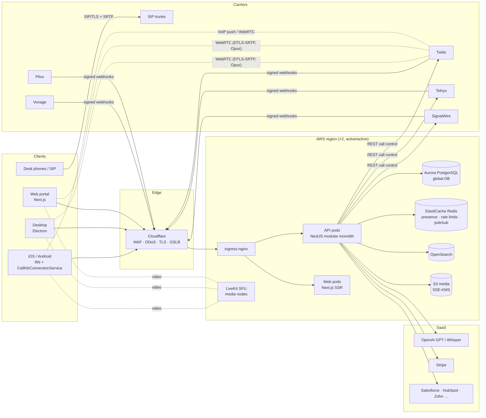
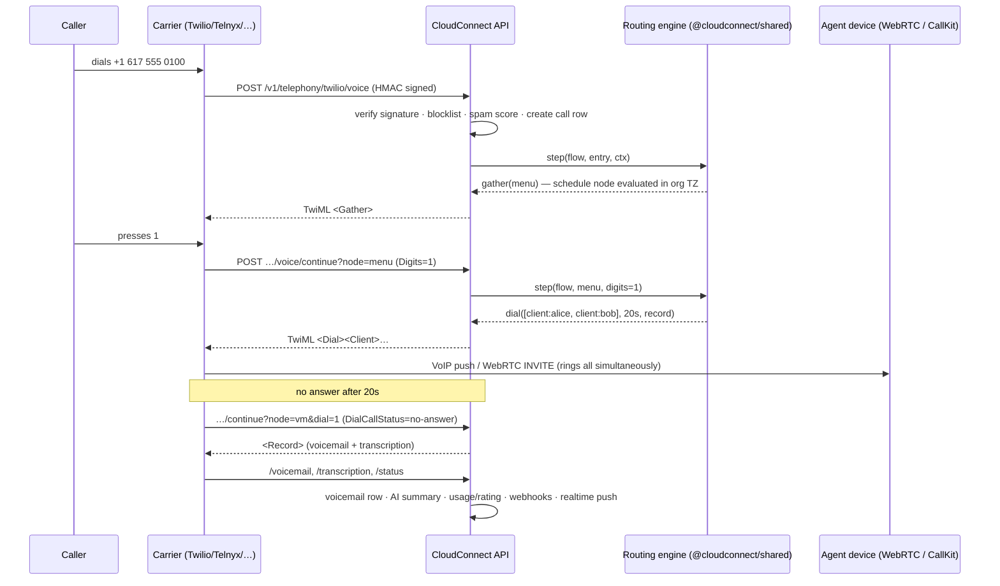

# CloudConnect AI — System Architecture

## 1. Overview

**Design choice — modular monolith first.** The API is one deployable composed of bounded-context
modules (`auth`, `directory`, `numbers`/`routing`, `telephony`, `calls`, `messaging`, `contacts`,
`meetings`, `billing`, `analytics`, `admin`, `search`, `realtime`, `graphql`). Contexts talk through
the `EventBus` and their own tables, so any of them can be carved out into its own service without a
rewrite (see §7). This keeps latency on the call path low (a carrier webhook is answered in one hop)
and keeps operational overhead proportional to team size.

## 2. Call path (inbound PSTN → IVR → ring group → voicemail)

The routing engine is a **pure function** shared by the API (production) and the admin portal's
*test-call simulator*, so what admins test is byte-for-byte what callers get. Provider dialects
(TwiML for Twilio/SignalWire/Telnyx TeXML, Plivo XML, Vonage NCCO) are rendered by
`apps/api/src/modules/telephony/render.ts`.

Supported node types: business hours/holidays (IANA time zones, overnight & partial-day ranges),
language selection (multi-language IVR), IVR menu (retries, timeout/invalid fallbacks), ring groups
(simultaneous, sequential/hunt, round-robin, longest-idle), forward, queue, AI receptionist,
announcement, voicemail, hang-up. Validation rejects dangling edges and the engine detects loops.

## 3. Real-time channels

| Channel | Transport | Notes |
|---|---|---|
| Voice media | WebRTC (Opus, DTLS-SRTP) via carrier SDK; SIP/TLS + SRTP for desk phones/trunks | Media never transits our pods; HD voice, AEC/NS/AGC in clients |
| Video | LiveKit SFU (simulcast, screen share, egress recording) | Tokens minted by `/v1/meetings/:code/join` with per-role publish grants |
| App events | Socket.IO on `/ws` (JWT auth), Redis pub/sub fan-out across replicas | Incoming-call toasts, presence, typing, read receipts, new messages |
| Integrations | Signed webhooks (HMAC-SHA256 `t=…,v1=…`), exponential retry 30s→6h | SSRF-guarded (https only, no private IPs, no redirects) |

## 4. AI services

`AiService` wraps OpenAI (chat completions with JSON output, Whisper STT) and **always has a
deterministic fallback** (`analyzer.ts`), so every feature works — and every test runs — without
an API key. Features: call/meeting summaries, sentiment, action items, keywords, 0–100 call score,
sales/support coaching tips, voicemail summaries, SMS reply drafting, translation, and the AI
receptionist (speech `<Gather>` loop that can answer, transfer to a department node, book an
appointment into `meetings`, or take a message). Transcripts and insights are stored per tenant;
HIPAA tenants can disable AI per org (`settings.aiFeatures`).

## 5. Scaling to 1M+ users

Sizing assumption: 1M users ≈ 20k tenants, peak 5% concurrently on calls (50k concurrent calls),
~3k carrier webhooks/s, ~1M websocket connections.

| Tier | Strategy |
|---|---|
| API | Stateless pods, HPA on CPU + RPS (3 → 200 per region), PDB 66%, zone spread. Carrier webhooks are O(3–5) indexed queries; p95 target < 100 ms. |
| Websockets | ~20k sockets/pod → ~50 pods/region at peak; Redis pub/sub fan-out; Cloudflare cookie affinity keeps a client in one region. |
| PostgreSQL | Aurora writer + up to 15 readers; analytics on readers. `calls`, `messages`, `audit_logs`, `usage_records` monthly-partitioned via pg_partman (≈2B call rows/yr). Tenancy key `org_id` leads every hot index. Pooled via RDS Proxy/PgBouncer. Beyond one writer: shard by `org_id` (Citus or app-level cell routing — see §7). |
| Redis | Cluster mode (3 shards × 2), presence keys with TTL, sliding-window rate limits. |
| Media | Carriers handle PSTN/WebRTC media; LiveKit media nodes on public subnets, autoscaled on UDP pps. |
| Search | OpenSearch indices filtered by `org_id`; indexing is async from the event bus so the call path never waits on it. |
| Storage | S3 Intelligent-Tiering after 30 days; per-tenant retention policies purge recordings. |

## 6. High availability & disaster recovery (99.99%)

* **Two active regions** (us-east-1, eu-west-1), each 3 AZs. Cloudflare health-checks `/health/ready` every 15 s and fails a region out automatically.
* **Aurora Global Database**: < 1 s replication; managed failover promotes eu-west-1 (RPO ≈ 1 s, RTO ≈ 1–2 min). Reads already served locally.
* **S3 cross-region replication** for media; **AWS Backup** daily snapshots copied cross-region (35/90-day retention) on top of Aurora 35-day PITR.
* **Carrier redundancy**: numbers can be re-pointed between providers (`phone_numbers.provider`); webhook URLs are region-agnostic (`api.cloudconnect.ai`).
* Zero-downtime deploys: `maxUnavailable: 0`, preStop drain, readiness gates, one region at a time with automatic `rollout undo`.
* Error budget: 99.99% ≈ 4.3 min/month. Alerts page on 1% 5xx over 5 min and on carrier-webhook p95 > 250 ms (dead air for callers).

## 7. Service decomposition path

When a context outgrows the monolith, extract it behind the same event contracts:
1. **telephony-edge** (webhooks + call control) — latency-critical, scales with call volume.
2. **messaging** (SMS/MMS/chat, campaign sender) — throughput-bound, carrier rate limits.
3. **ai-worker** (transcription/analysis queue) — GPU/LLM cost isolation.
4. **analytics** — CDC (Debezium) from Postgres into ClickHouse for long-range reports.
5. **Cells**: for > ~50k tenants, run independent regional "cells" (full stack + DB) and route tenants by `org_id` at the edge.

## 8. Repository map

| Path | Contents |
|---|---|
| `packages/shared` | Routing engine, schedules/time zones, RBAC, plans & rating, phone utils (+ unit tests) |
| `apps/api` | NestJS API, SQL migrations, seed, unit & integration tests |
| `apps/web` | Next.js user + admin portal, softphone, IVR builder/simulator, Playwright e2e |
| `apps/mobile` | Expo/React Native app, CallKit/ConnectionService, Swift widget/intents/watch sources |
| `apps/desktop` | Electron shell (Windows/macOS/Linux) |
| `infra/` | Dockerfiles, compose, NGINX, k8s (kustomize), Terraform (AWS multi-region), monitoring |
| `docs/` | Architecture, database, API (OpenAPI + GraphQL SDL), security, deployment, user guide |
