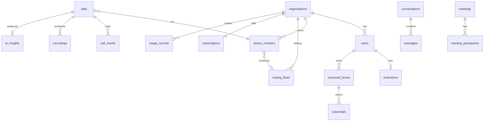

# Database schema

PostgreSQL 16 (Aurora in production). Source of truth: `apps/api/db/migrations/*.sql`
(forward-only, applied under an advisory lock by `scripts/migrate.ts`).

## Tenancy
Every tenant-owned table has `org_id`. Isolation is enforced twice:
1. **Service layer** — every query filters by the caller's `org_id` (from the JWT/API key).
2. **Row-level security** (`002_rls.sql`) — policies on all tenant tables compare `org_id` with
   `current_setting('app.org_id')`, set per transaction by `Db.tx(orgId, …)`. Production runs the
   API as a non-owner role so RLS applies; migrations run as the owner.

## Entity overview

| Domain | Tables |
|---|---|
| Identity | `organizations`, `users`, `oauth_identities`, `sessions` (rotating refresh tokens, family reuse detection), `devices`, `teams`, `team_members`, `api_keys` |
| Phone system | `extensions`, `phone_numbers`, `routing_flows` (JSON flow graph, versioned), `port_requests`, `sip_trunks`, `blocked_numbers`, `voicemail_boxes` |
| Calls | `calls` (lifecycle, cost, quality MOS/jitter/loss, spam score, routing path), `call_events` (hold/transfer/park/barge/AI turns), `recordings`, `voicemails`, `transcripts`, `ai_insights` |
| Messaging | `conversations` (sms, group_sms, team_chat, direct_chat), `messages` (status, segments, media, scheduling, read receipts), `sms_templates`, `auto_replies`, `campaigns`, `sms_opt_outs` |
| Contacts | `contacts` (GIN indexes on phones/tags), `contact_groups` |
| Meetings | `meetings` (waiting room, passcode hash, webinar mode, calendar ids), `meeting_participants` (roles, breakout rooms) |
| Billing | `subscriptions`, `usage_records`, `invoices`, `coupons`, `rates` (longest-prefix international deck) |
| Platform | `webhooks`, `webhook_deliveries`, `integrations` (AES-GCM encrypted credentials), `audit_logs`, `fraud_events` |

## Scale notes
* Partition `calls`, `messages`, `audit_logs`, `usage_records`, `call_events` monthly with pg_partman (`partman.create_parent('public.calls','started_at','native','monthly')`) once a tenant cell passes ~100M rows; PKs become `(id, started_at)`.
* Hot indexes lead with `org_id` (`calls_org_started`, `conversations_org_last`, `audit_org_time`).
* `duration_seconds` is a generated column so it cannot drift from timestamps.
* Retention: a nightly job deletes recordings past `organizations.settings.recordingRetentionDays` and S3 lifecycle removes the objects; audit logs are kept 7 years for compliance tenants.
